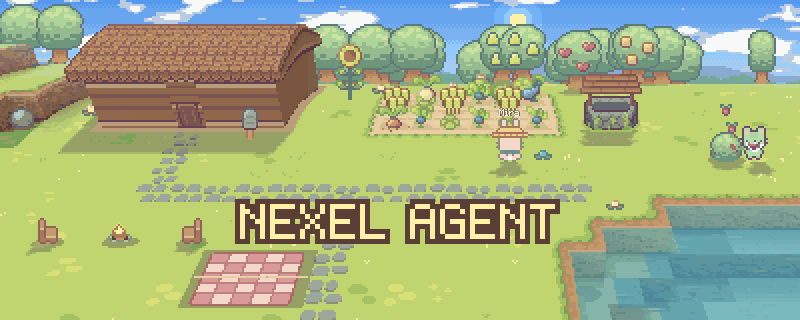

<b>AI players for Nexel Worlds: a trained body, a local mind, real memories.</b>

  <a href="https://sofianedjerbi.github.io/nexel-website/play/"><b>Play in your browser</b></a> &nbsp;·&nbsp;
  <a href="https://sofianedjerbi.github.io/nexel-website/play/brain/"><b>Watch an AI player think</b></a> &nbsp;·&nbsp;
  <a href="https://sofianedjerbi.github.io/nexel-website/devlog/"><b>Devlog</b></a>

The mind runs locally on Qwen3-30B-A3B-Instruct-2507 (4-bit, MLX). Run one against a local game: see <a href="CONTRIBUTING.md">Contributing</a> · <a href="https://github.com/sofianedjerbi/nexel-worlds">the game</a> · MIT

