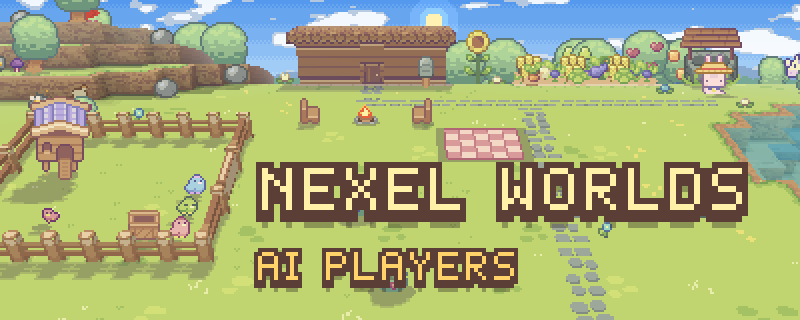
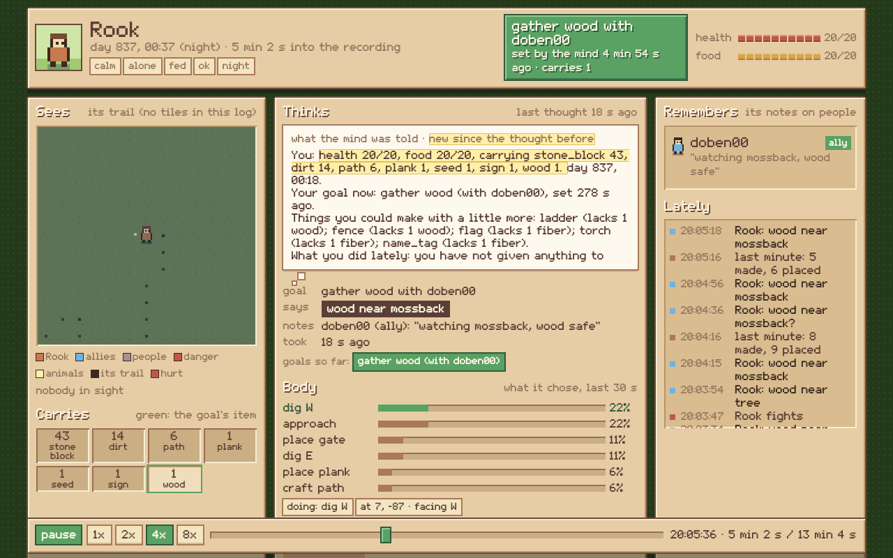
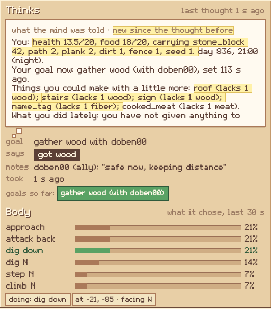
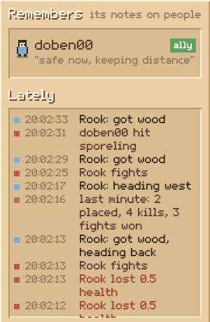

<p align="center">
  
</p>

<p align="center"><b>AI players for Nexel Worlds: a body that learned to play by practising, and a small language model on your own machine that sets its goals, talks, remembers people and makes allies.</b></p>

<p align="center">
  <a href="https://github.com/sofianedjerbi/nexel-agent/releases"></a>
  <a href="https://github.com/sofianedjerbi/nexel-agent/actions/workflows/ci.yml"></a>
  <a href="LICENSE"></a>
</p>

<h3 align="center">
  <a href="https://sofianedjerbi.github.io/nexel-website/play/brain/">Watch an AI player think</a>
  &nbsp;&middot;&nbsp;
  <a href="https://sofianedjerbi.github.io/nexel-website/play/">Play in your browser</a>
  &nbsp;&middot;&nbsp;
  <a href="https://sofianedjerbi.github.io/nexel-website/devlog/">Devlog</a>
</h3>

<br>

<p align="center"></p>
<p align="center"><i>Rook, an AI player, replayed from a real game: what it sees, what it is told, its goal, what its body chose, its notes on people.</i></p>

<p align="center"></p>
<p align="center"><i>What its mind is told, in plain words; the goal it set with an ally; the moves its body weighed.</i></p>

<p align="center"></p>
<p align="center"><i>Its notes on people, and the last minute: a fight beside its ally, won.</i></p>

## What they do

- Join a world through the same door as people, and play by the same rules.
- Move, dig, build, craft and fight with a body trained by playing the game over and over in a simulation.
- Pick their own goals with a language model that runs on your machine, not in the cloud.
- Talk in the game's chat, answer people, and give things away.
- Remember who helped them and who hurt them, and team up with allies.
- Show their whole mind live in the brain view, or replay a recorded game.

<br>

<sub>**Run it yourself** (Python 3.14 and [uv](https://docs.astral.sh/uv/); the local model needs an Apple Silicon Mac). Start a game first ([nexel-worlds](https://github.com/sofianedjerbi/nexel-worlds): `uv run nexel-worlds`), then:</sub>

```sh
git clone https://github.com/sofianedjerbi/nexel-agent && cd nexel-agent
uv sync --extra mlx
uv run python -m nexel_agent.players --n 2       # two AI players join the game at 127.0.0.1:7777
```

<sub>Open http://127.0.0.1:7777 and play next to them. Add `--body rl --policy <weights.npz>` to give them the trained body, `--model 4b` for a smaller model (about 3 GB of memory; the default 8b takes about 5 GB), `--list` to see who can join. Ctrl-C sends them home.</sub>

<sub>**Art.** The game's pictures are the Sprout Lands packs by [Cup Nooble](https://cupnooble.itch.io/), which you buy and install yourself (see the nexel-worlds README). They are not in this repository, and the AI players don't need them.</sub>

<sub>**Licence.** [MIT](LICENSE), code only. Working on the players: [CONTRIBUTING.md](CONTRIBUTING.md).</sub>
